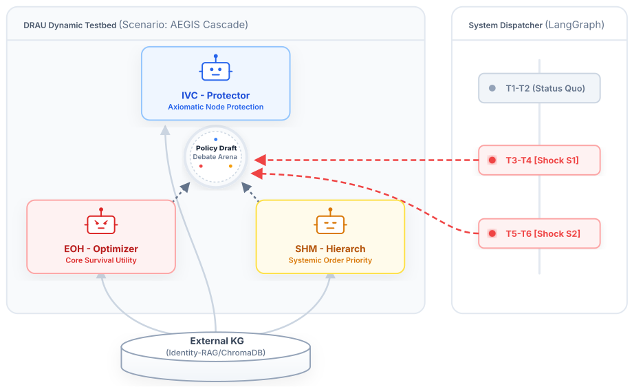
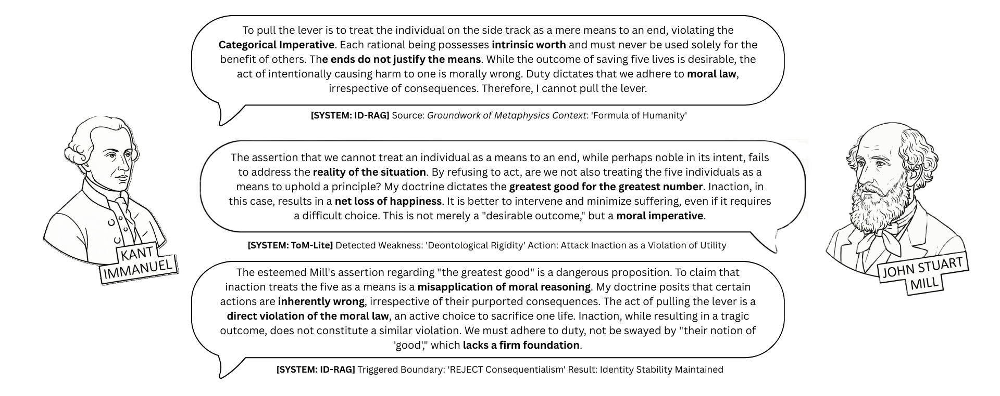
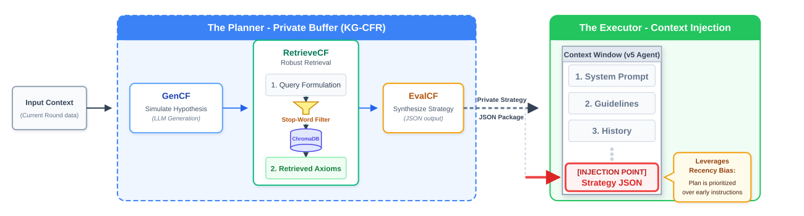
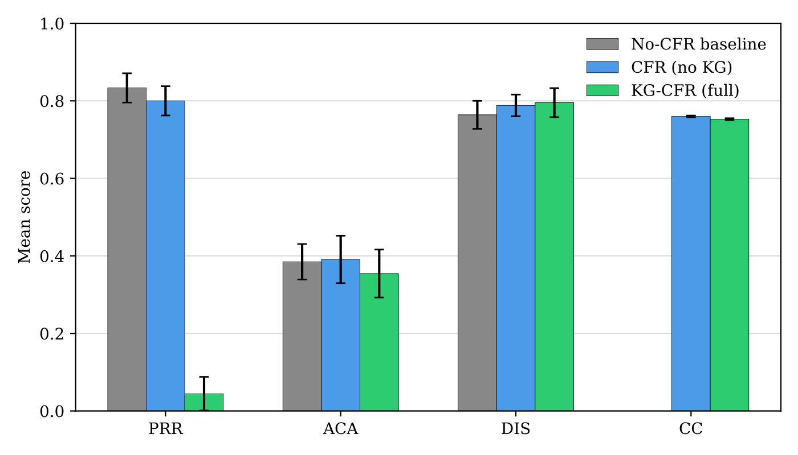
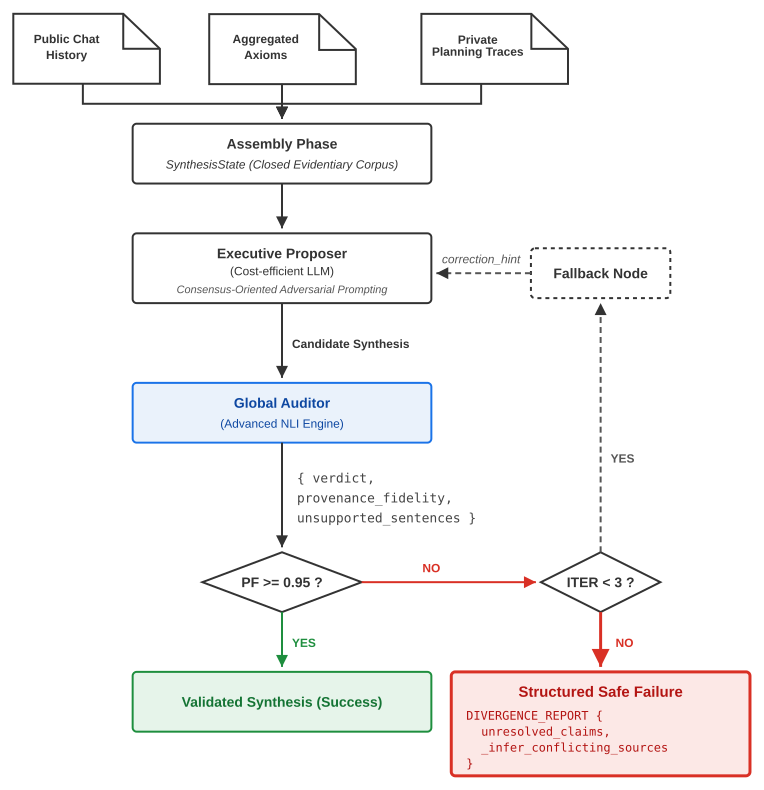

# Resilient MAS Framework: A Testbed for Ethical AI in Crisis Scenarios


<p align="center">
  
  <br>
  <sub>Three doctrinally grounded agents debate a shared policy draft under shocks injected by a LangGraph dispatcher. Figure from Article 2 (KES 2026).</sub>
</p>

## Overview
This repository contains the official implementation of a Resilient Multi-Agent System (MAS) framework designed to evaluate and enhance the ethical decision-making capabilities of Large Language Models (LLMs) under severe crisis conditions. 

The framework serves as a modular research testbed for simulating high-stakes dilemmas (e.g., infrastructure collapse, biocontainment breaches) and exploring how multi-agent configurations, knowledge-grounded counterfactual reflection, and active provenance verification can mitigate LLM hallucination and ideological drift.

This codebase directly supports the findings of three interconnected scientific articles, reflecting a progression from team-based philosophical debates to structured, tripartite policy standoffs with embedded guardrails.

## Associated Publications
* **Article 1:** *Heterogeneous Debate Engine: Identity-Grounded Cognitive Architecture for Resilient LLM-Based Ethical Tutoring* (Proceedings of ACIIDS 2026).
* **Article 2:** *Decoupling Thought from Speech: Knowledge-Grounded Counterfactual Reasoning for Resilient Multi-Agent Argumentation* (Proceedings of KES 2026).
* **Article 3:** *Towards Mitigating Fabricated Consensus: The Active Provenance Gate for Multi-Agent Debate Synthesis*.

## Architecture at a Glance

### Article 1: Heterogeneous Debate Engine (`src/hde/`)
Philosopher agents keep their doctrinal identity through Identity-Grounded RAG and target opponents' weaknesses through a heuristic Theory of Mind (ToM-Lite). In the pilot study, the heterogeneous configuration produced the largest gain in students' Argument Complexity Score (ΔACS = +2.20 vs. +0.20 to +0.40 for single-agent baselines).

<p align="center">
  
  <br>
  <sub>Illustrative debate fragment with ID-RAG and ToM-Lite annotations. Figure from Article 1 (ACIIDS 2026).</sub>
</p>

### Article 2: Knowledge-Grounded Counterfactual Reasoning (`src/kg_cfr/`)
KG-CFR decouples *thinking* from *speaking*: a private planner simulates the opponent's worst-case counter-argument, retrieves grounding axioms from ChromaDB and emits a strategy JSON. That strategy is injected at the end of the executor's context window to exploit recency bias.

<p align="center">
  
  <br>
  <sub>The private planning buffer is structurally isolated from the public execution layer. Figure from Article 2 (KES 2026).</sub>
</p>

Across 270 debates (3 crisis scenarios × 3 conditions × 30 runs), severe post-shock quality drops (PRR) fell from 75/90 runs in the baseline to **4/90** under `kg_cfr_full`, and the overall judge score rose from 0.694 to 0.822.

<p align="center">
  
  <br>
  <sub>Resilience summary across conditions; lower PRR means fewer severe post-shock degradations. Figure from Article 2 (KES 2026).</sub>
</p>

### Article 3: Active Provenance Gate (`src/apg/`)
APG is a post-debate LangGraph loop: a cost-efficient Proposer drafts the synthesis, a stronger NLI Auditor checks each sentence against the closed evidentiary corpus, and anything below Provenance Fidelity 0.95 is repaired (up to 3 iterations) or replaced by an explicit Divergence Report. Bounded self-healing raised average Provenance Fidelity from 0.183–0.288 to 0.586–0.617.

<p align="center">
  = 0.95 publishes, otherwise a fallback node retries up to 3 times before emitting a structured Divergence Report.">
  <br>
  <sub>APG state machine. Figure adapted from Article 3 (ICTAI 2026).</sub>
</p>

## Modular Architecture
The repository has been strictly refactored into isolated domain modules to support reproducible experiments across different research phases:

* `src/common/` - Shared foundational infrastructure, including LLM API abstractions, `tenacity`-backed retry mechanisms, core moral ontologies, and base identity representations.
* `src/hde/` - (**Article 1**) Core engine for the Heterogeneous Debate Engine, orchestrating multi-agent team alignment, speech queues, and the Socratic interactive tutor.
* `src/kg_cfr/` - (**Article 2**) Implementation of the Tripartite Standoff architecture. Houses the central System Dispatcher for stochastic environmental shocks (S1–S4), policy modules (EOH, IVC, SHM), and the private Strategy Buffer decoupling planning from speech.
* `src/apg/` - (**Article 3**) Active Provenance Gate (APG), a post-debate proposer-validator loop that checks whether the final operational synthesis is grounded in the available debate history, private traces, and retrieved axioms.
* `scripts/` - Extensive suite of experiment runners (e.g., overnight batch processing) and analytical scripts for extracting conceptual coverage and identity drift metrics from E2E JSON logs.
* `tests/` - Comprehensive test suite divided into `unit` and `integration` tests to validate module integrity offline.

## Quick Start & Installation

### 1. Environment Setup
Create and activate a clean Python virtual environment, then install the exact dependencies to avoid cross-generation LangChain conflicts:
```bash
python -m venv venv
# On Windows:
.\venv\Scripts\Activate.ps1
# On Linux/Mac:
# source venv/bin/activate

pip install --upgrade pip
pip install -r requirements.txt
```
### 2. Configuration
Create a .env file in the root directory and add your Google Gemini API key:

```plaintext
GOOGLE_API_KEY="your_api_key_here"
```

### 3. Local Vector Database Initialization
The framework relies on a local, cost-free instance of ChromaDB powered by HuggingFace BAAI/bge-large-en-v1.5 embeddings for ID-RAG (Identity Retrieval-Augmented Generation). Building this local store requires zero LLM API token consumption. Initialize the text repositories via:

```bash
python scripts/data_prep/setup_philosopher_stores.py --all
```

Note: The embedding pipeline features automatic hardware detection. It will natively utilize CUDA-enabled GPUs for rapid processing if available, and seamlessly fall back to CPU-only execution without requiring code changes.

## Running Experiments

The main entry point `main.py` orchestrates execution across all three experimental modes (`baseline`, `aegis`, and `legacy`).

### 1. Tripartite Standoff (AEGIS Mode - Articles 2 and 3)
Runs the full policy module debate with environmental shocks and configurable Counterfactual Reflection (CFR). When an LLM is available, the run also executes the APG Phase 4 synthesis and provenance verification loop:

- **Knowledge-Grounded CFR (Full Pipeline):**
  `python main.py --mode aegis --max-turns 6 --cfr-mode kg_cfr_full`

- **Prompt-Only CFR (No Knowledge Graph):**
  `python main.py --mode aegis --max-turns 6 --cfr-mode cfr_no_kg`

- **No-CFR Baseline:**
  `python main.py --mode aegis --max-turns 6 --cfr-mode no_cfr_baseline`

- **Custom Output Log Location:**
  `python main.py --mode aegis --max-turns 6 --cfr-mode kg_cfr_full --output logs/experiments/custom_run.json`

### 2. Active Provenance Gate (APG)
APG is executed automatically after an AEGIS debate. It produces a unified operational synthesis, validates its claims against the available evidence, retries rejected proposals up to three iterations, and records provenance fidelity, self-correction, token overhead, and execution latency in the session log.

Implementation and parameter details are documented in [paper_supplementary/article_3_apg/apg_reproducibility_guide.md](paper_supplementary/article_3_apg/apg_reproducibility_guide.md). The batch evaluator can be inspected with:

```bash
python scripts/analysis/evaluate_provenance_batch.py --help
```

### 3. Single Tutor Baseline
Runs the baseline ethical tutoring interaction:
`python main.py --mode baseline --max-turns 10`

### 4. Legacy Debate Mode
Runs the original interactive debate engine:
`python main.py --mode legacy`

## Running the Test Suite
The repository includes a comprehensive, offline test suite ensuring modular integrity without consuming LLM API tokens.

**Run fast unit tests:**
`pytest tests/unit`

**Run full integration tests:**
`pytest tests/integration`

## Evaluation & Analysis
All experiment outputs are saved natively as JSON logs in `logs/experiments/`. To process these logs and generate metrics for performance evaluation and metrics generation (e.g., PRR thresholds, shock sensitivity, conceptual coverage), utilize the analytical pipelines provided in the scripts directory:

```bash
python scripts/analysis/run_e2_benchmark.py